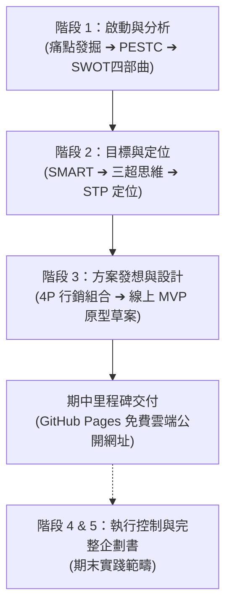
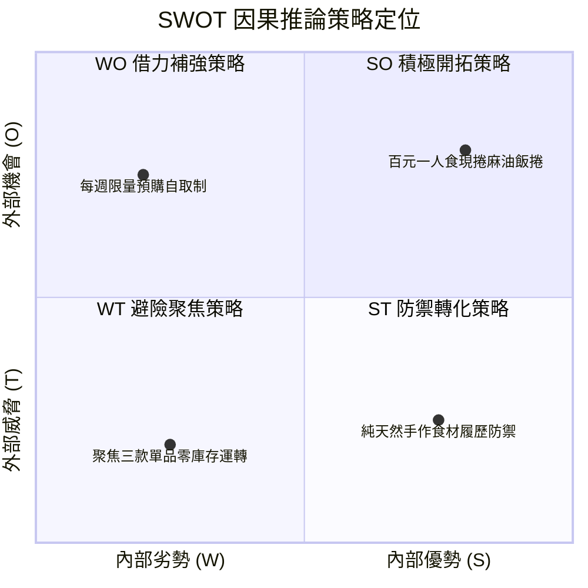
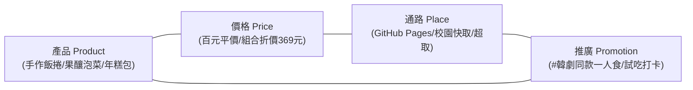

# 萬能科技大學《創意發想與實踐》期中行銷企劃書
## 專案名稱：《首爾小灶 SEOUL BITE》一人份道地韓食微型體驗

- **課程名稱**：創意發想與實踐（11501）
- **授課教師**：邱俊維 博士
- **教學地點**：G104 多媒體教室
- **實踐模式**：100% 個人獨立微型創業專案（零伺服器主機成本、零課後額外負擔）
- **學理依據**：凌政文 教授著《行銷企劃》（五階段標準流程 SOP：階段 1 ～ 階段 3 期中評量終點）
- **線上 MVP 原型部署成果**：`https://auo0528508-glitch.github.io/seoul-bite/`

---

## 專案執行摘要 (Executive Summary)

本企劃針對時下年輕學子與都會小資族「一人想吃道地韓食卻難開大鍋、外送冷硬且平台抽成過高、市售進口調理包化學添加多」等核心痛點，創立微型創業品牌**《首爾小灶 SEOUL BITE》**。

本專案堅持「100% 個人微型創業、輕資產運作（初始資金 3~5 萬、一人作業、無實體門市租金壓力）」，以「一人份現做麻油手作飯捲」、「天然果釀慢酵泡菜」與「3分鐘即食辣炒年糕獨享包」為三大核心明星單品。線上透過 **Google Antigravity** 快速建構 MVP 靜態展示型錄，並利用 **GitHub Pages** 免費發布全球公開網站，無縫串接校園定點快取與超取預購，達成低風險、高毛利、零呆滯庫存的微型餐飲創業模式。

---

## 步驟 1：【發掘痛點與創業動機】

### 1.1 三大具體痛點剖析

1. **一人用餐難開鍋，客單價居高不下（邊緣人與小資族社交痛點）**
   傳統韓式餐館（如韓式烤肉、一隻雞、部隊鍋）主要針對 2~4 人聚餐設計，平均客單價動輒 NT$ 350~550 元。單身族、外宿大學生若想解饞，不僅份量過大難以消化，還常面臨被店家收取額外單人開鍋費的窘境。
2. **市售大包裝進口品過度添加且口味死甜（品質與健康信任痛點）**
   量販賣場引進之工業化韓式調理包，多添加高劑量防腐劑、人工增稠劑與甜味劑以求長期常溫保存，風味死甜偏膩，無法展現正統韓食講究的「天然水梨發酵甘醇」與「現刷初榨芝麻油」的原始鮮香。
3. **外送平台抽成高昂且餐點易冷硬變質（微型創業與配送痛點）**
   餐飲外送平台向店家抽取 32%~38% 高額手續費，且運送耗時常導致海苔飯捲受潮軟爛、辣炒年糕凝固變硬。若微型創業者採用低溫冷凍宅配，每筆運費高達 NT$ 160~225 元，成為顧客下單的巨大心理門檻。

### 1.2 創業切入緣起
《首爾小灶》以「百元小資無負擔、一人獨享份量、3分鐘免開火即享」切入市場，透過小批量新鮮手作、校園面交快取與極簡真空鎖鮮包裝，化繁為簡，讓正統首爾街頭香氣無痛走入生活日常。

---

## 步驟 2：【外部總體環境 PESTC 深度分析】

| 構面 | 外部趨勢觀察 | 對本微型創業企劃之啟發與契機 |
| :--- | :--- | :--- |
| **P (政治法律)** | 衛福部嚴格落實食品良好衛生規範 (GHP)，消費者對食材產地、豬肉來源及食品標示透明度極度敏感。 | 主動在線上專頁與包裝上完整揭露肉品檢驗證明、產地履歷，以「透明乾淨無添加」構築微型品牌信任感。 |
| **E (經濟環境)** | 通膨推升整體外食費用，年輕消費者產生抗跌之「口紅效應」，追求小額但能帶來極致幸福感的生活小確幸。 | 以 NT$ 110~160 的平實定價切入，加上「校園定點免運費自取」，避開高昂外送抽成，顯著提升首購下單轉化率。 |
| **S (社會文化)** | K-Pop、韓劇與韓國綜藝席捲全台青年族群，「追劇必備韓食」已成大學生及租屋族深植的文化休閒儀式。 | 掌握韓食「一人食」與「療癒陪伴」的精神象徵，透過社群視覺營造如韓劇女主角深夜開動的溫暖氛圍。 |
| **T (科技創新)** | 商用食品真空封口機與小型急凍技術普及且成本低廉，社群微電商搭配靜態網頁快速發布技術成熟。 | 微型個人工作室即可達成專業級高阻隔食品保鮮；運用 Google Antigravity 與 GitHub Pages 實現 0 元架站。 |
| **C (綠色環保)** | 減碳減塑成為青年共識，重視食物里程與在地友善農業。 | 核心食材優先結合在地優質農產（台灣優選壽司米、在地甘藍白菜），輔以韓國原裝進口純芝麻油，既減碳又保有道地靈魂。 |

---

## 步驟 3：【內部資源盤點與假想敵防護】

### 3.1 創辦人內部資源評估
- **內部優勢 (Strengths)**：
  - 輕盈敏捷、無實體店租金與專職人事包袱。
  - 具備 Google Antigravity 提示詞工程與 GitHub Pages 零伺服器雲端建置能力。
  - 對正統韓式配方、辣椒粉比例與水梨發酵工法有深度研究與手作熱忱。
- **內部劣勢 (Weaknesses)**：
  - 啟動資金有限（約 3~5 萬元）。
  - 一人獨立作業，每日出餐量與備料產能受限於個人工時。
  - 缺乏大型連鎖通路的品牌知名度與採購議價優勢。

### 3.2 假想敵精準辨認
- **主要假想敵**：連鎖量販大賣場之進口廉價大包裝料理包，以及校園周邊重度調味、非道地之平價台式混血便當。
- **假想敵弱點**：大量工廠預製導致化學添加物多、口感偏甜、包裝笨重、缺乏新鮮溫度與儀式感。

### 3.3 定位防護策略
- **避開正面價格廝殺**：不與工業流水線比拼超低價，專注於「手工慢熬無添加」、「初榨芝麻油現刷現捲」之極致新鮮度。
- **小批量預約制護城河**：採行限量登記預購，將「產能有限」劣勢轉化為「新鮮出爐、絕無隔夜」的獨家稀缺賣點。

---

## 步驟 4：【SWOT 因果推論四象限四部曲綜合矩陣】

### 4.1 SO 積極開拓策略（優勢 × 機會）
充分發揮「純芝麻油現刷濃香」與「一人獨享份量」的產品力，搭乘校園韓劇話題熱潮，以百元平價飯捲主攻「學生追劇、考前夜讀」宵夜場，並在 Dcard 與 Instagram 引爆口碑裂變。

### 4.2 WO 借力補強策略（劣勢 × 機會）
面對單人備料產能有限的限制，借力校園生活圈的高度便利性，全面採取「每週二、四限額 25 份預訂自取制」，將「產能受限」自然化為「產地直發、限時限量」的尊榮感，徹底消除食材報廢耗損。

### 4.3 ST 防禦轉化策略（優勢 × 威脅）
面對量販賣場進口包的低價競爭威脅，主動將製作過程透明化，以短影音公開「富士蘋果現磨發酵」與「無防腐劑、無化學人工色素」的真材實料，以極致安心築起同質性競爭者難以跨越的信任防線。

### 4.4 WT 避險聚焦策略（劣勢 × 威脅）
啟動資金僅 3 萬元，不租實體門店、不添購大型重設備。專注打磨「手作海苔飯捲」、「果釀熟成泡菜」、「DIY 辣炒年糕包」三款爆款核心單品，確保備料材料可高度跨品項通用，維持零庫存呆滯的高周轉營運模式。

---

## 步驟 5：【SMART 企劃目標與三超前瞻思維】

### 5.1 SMART 量化企劃目標（30 天 MVP 期中驗證）
- **S (具體 Specific)**：完成《首爾小灶》GitHub Pages 雲端專頁建置，上線展示 3 款微型韓食產品，並串接預購登記意向。
- **M (可衡量 Measurable)**：專頁上線 30 天內達成 250 次真實訪客點閱，並收集至少 35 份試吃預購登記。
- **A (可達成 Attainable)**：依託校園社群、系學會、宿舍交誼圈與社群好友擴散，目標明確且穩健可達成。
- **R (相關性 Relevant)**：透過真實預購數據驗證「一人份道地韓食」在校園與微型市場之付費意願，作為期末決策基礎。
- **T (時限 Time-bound)**：於學期第八週前完成 GitHub 部署與 Google 表單串接，並在第十週前完成首批試吃交付。

### 5.2 「三超」前瞻思維實踐
1. **超前意識**：先以低設備成本、短備料週期的「手作冷食飯捲」與「常溫/微冷藏年糕料理包」切入市場驗證，為未來的韓式中央私廚與訂閱制便當奠定忠實會員基石。
2. **超越常規**：打破韓食必須「大火熱炒、多人分食、大鍋共食」的傳統刻板框架，將複雜料理拆解為 3 分鐘電鍋/微波即享的個人輕食。
3. **超越期望**：每一份餐點均隨附手寫「韓文暖心問候籤詩小卡」與「特調初榨香油精緻滴管包」，讓消費者自行決定香氣濃度，創造驚艷開箱體驗。

---

## 步驟 6：【STP 市場定位與 4P 行銷組合】

### 6.1 STP 市場定位策略
- **市場區隔 (Segmentation)**：依生活形態與用餐型態劃分，鎖定重視便利、喜愛韓流文化、外宿自理之青年學生與單身小資族。
- **目標客群 (Targeting)**：18~30 歲校園學生與剛出社會的新鮮人（一人居住、外食族、追劇族）。
- **品牌定位 (Positioning)**：
  > **「首爾小灶，一人也能大口享受的道地韓食溫度。」**  
  > 專注於提供無負擔、一人份、3分鐘即享的手作道地韓味微型美食。

### 6.2 4P 行銷組合方案

#### 1. 產品 (Product)：三大明星單品
- **明星單品 A：【經典麻香】韓式手作海苔飯捲 (Classic Kimbap)**
  - 規格：280g / 盒（切片），常溫即食。
  - 特色：嚴選大甲米刷滿韓國不倒翁純芝麻油，捲入特醃韓式醬燒牛、黃金脆醃蘿蔔條、鮮脆牛蒡與綠菠菜。附獨立防潮包裝。
- **明星單品 B：【天然果釀】極鮮手工熟成泡菜 (Craft Fermented Kimchi)**
  - 規格：350g 真空玻璃罐裝。
  - 特色：新鮮富士蘋果與水梨磨泥慢酵，佐以韓國原裝辣椒粉與野生蝦醬，無化學添加，酸甘香脆。
- **明星單品 C：【首爾街頭】辣炒年糕 DIY 獨享包 (Seoul Tteokbokki Pack)**
  - 規格：260g 一人份真空料理包。
  - 特色：Q彈純米條、韓國釜山薄魚板、特釀黃金甜辣醬。免退冰加半碗水滾煮 3 分鐘即食。

#### 2. 價格 (Price)
- 經典手作飯捲：單盒 **NT$ 110**（市售餐廳約 NT$ 150~180）。
- 手工熟成泡菜：單罐 **NT$ 160**（350g 大容量）。
- 辣炒年糕獨享包：單包 **NT$ 130**。
- **期中爆款促銷**：【首爾狂熱】一人吃飽飽三件組（飯捲 + 泡菜 + 年糕）享特惠價 **NT$ 369**（現折 31 元）。

#### 3. 通路 (Place)
- **線上門面**：GitHub Pages 響應式靜態網頁（產品型錄與品牌理念）。
- **訂購轉化**：串接 Google 表單（即時接收訂單與統整備料）。
- **取貨方式**：
  - 校園定點快取：每週二、四中午於校門/宿舍交誼廳面交（0 元免運）。
  - 超商取貨：真空調理包提供 7-11 / 全家 店到店服務（運費 60 元）。

#### 4. 推廣 (Promotion)
- **#韓劇同款一人食 社群擴散挑戰**：鼓勵顧客上傳追劇搭配飯捲的限時動態，標記 `#首爾小灶`，下次回購折抵 15 元。
- **隨餐盲盒驚喜**：每筆訂單贈送「韓風復古貼紙」與「韓國柚子茶茶包」各一份，提升開箱回訪率。
- **校園早鳥口碑行銷**：前 20 位填寫預購者，贈送獨家「特製韓式拌飯香辣醬隨行包 (30ml)」。

---

## 步驟 7：【線上 MVP 網頁程式碼設計】

已為專案建立現代日系韓風高質感單頁式 `index.html`，具備以下專業特色：
1. **Mobile-First 響應式設計**：採用 Tailwind CSS，手機與電腦均能完美呈現。
2. **完整收錄四大精華模組**：
   - Hero 主視覺：搶眼吸睛的韓系溫暖色調與行動呼籲按鈕 (CTA)。
   - 品牌緣起與三大痛點對比卡片。
   - PESTC、SWOT 四象限與 SMART 學理矩陣完整展示。
   - 三大明星商品展售櫥窗與一人吃飽特惠組合。
   - 互動式「線上試吃預購意向登記表單」。

網頁本體已建立於工作目錄：[index.html](file:///C:/Users/J501/.gemini/antigravity/scratch/korean-cuisine-midterm/index.html)。

---

## 步驟 8：【部署至 GitHub Pages 雲端發布指引】

請依照以下簡單 3 個步驟，即可獲得期中報告必須繳交的公開網址：

1. **前往 GitHub 建立專案儲存庫**：
   - 登入 [GitHub](https://github.com/)，點擊右上角「+」➔ 選擇 **New repository**。
   - Repository name 輸入：`seoul-bite`。
   - 務必勾選 **Public**（公開），點擊綠色按鈕 **Create repository**。
2. **上傳網頁程式碼檔案**：
   - 進入儲存庫頁面，點選 **uploading an existing file**。
   - 將本機的 [index.html](file:///C:/Users/J501/.gemini/antigravity/scratch/korean-cuisine-midterm/index.html) 與 [README.md](file:///C:/Users/J501/.gemini/antigravity/scratch/korean-cuisine-midterm/README.md) 拖曳上傳。
   - 點擊下方綠色按鈕 **Commit changes**。
3. **啟用 GitHub Pages 雲端公開發布**：
   - 點選儲存庫頂部的 **Settings** ➔ 左側選單點選 **Pages**。
   - 在 **Build and deployment** 下方的 **Branch**：將 `None` 改選為 `main`，資料夾維持 `/(root)`，點擊 **Save**。
   - 靜候 1~2 分鐘後重新整理頁面，頂部即會出現綠色提示：
     > `Your site is live at https://[您的GitHub帳號].github.io/seoul-bite/`
   - 此網址即為期中報告繳交之「線上公開部署成果網址」！
